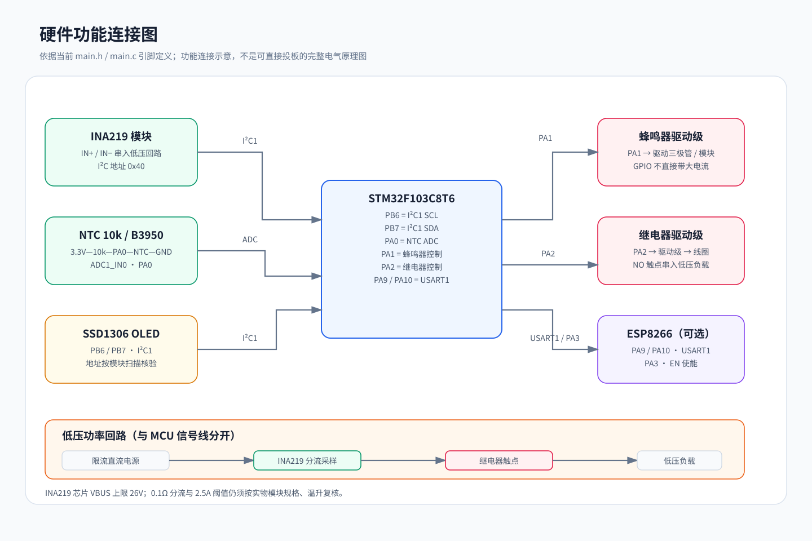
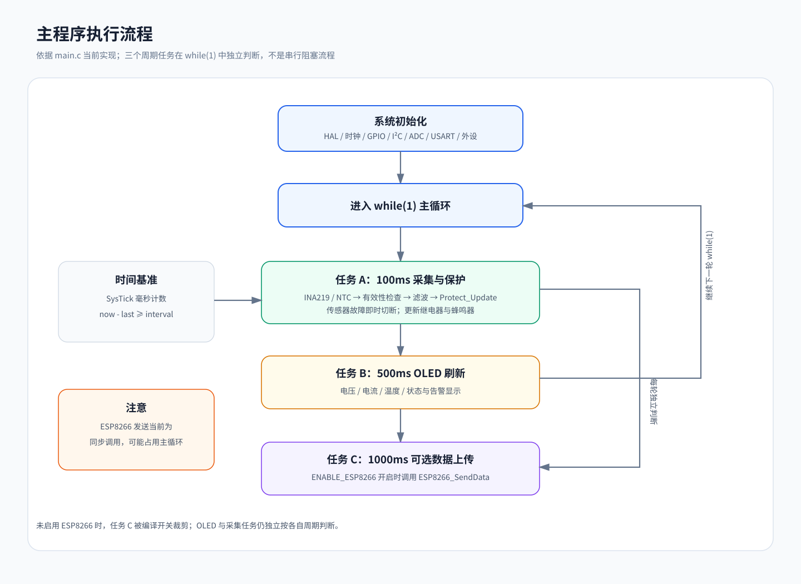
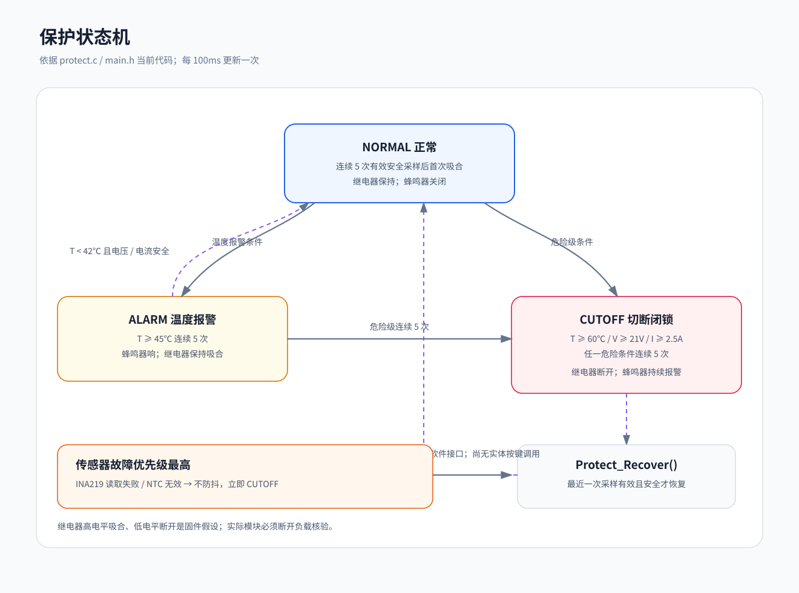
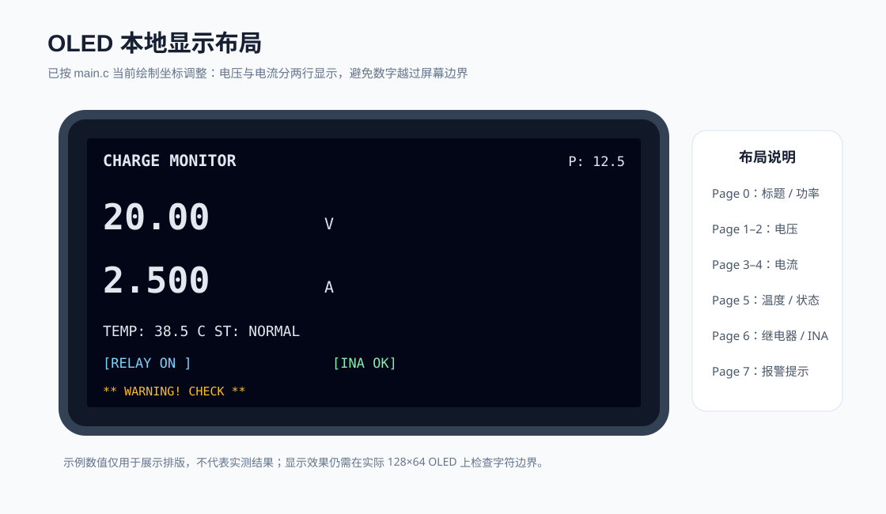

# 系统设计文档（DESIGN）

《基于 STM32 的智能充电监控显示系统设计》—— 需求、方案论证、软硬件设计、接口规范。

> 本文档为工程视角的设计说明；完整的论文级论述（含公式推导与参考文献）见毕业论文。

## 1 需求分析

### 功能性需求
| 编号 | 需求 | 验收口径 |
|------|------|----------|
| FR-1 | 低压侧电压/电流/功率实时采集 | 当前固件暂按 20V/2.5A 作为保守测试点；60W / 3A 属于目标扩展工况，须先重新设计分流器和功率通路 |
| FR-2 | 快充头外壳温度监测 | 目标分辨率 0.1℃；准确度与响应时间需由实物标定验证 |
| FR-3 | OLED 本地显示全部参数与状态 | 刷新 2Hz |
| FR-4 | 超温报警与继电器切断 | 45℃ 报警 / 60℃ 切断，可配置 |
| FR-5 | 物联网数据上传（可选） | MQTT JSON，1s 周期 |

### 非功能性需求
- 电压误差 ≤1%，电流误差 ≤2%（FR-1 采集链路）
- 目标连续稳定运行 ≥8h；当前软件包含采样滤波与超限防抖，抗干扰能力需实测
- 保护防误动：毛刺（<5 周期）不触发动作

## 2 方案论证

### 2.1 主控选型
| 候选 | 内核/主频 | RAM | 结论 |
|------|-----------|-----|------|
| STC89C52 | 8051/12MHz | 512B | 无硬件 I2C，无法承载 OLED 帧缓冲，淘汰 |
| **STM32F103C8T6** | Cortex-M3/72MHz | 20KB | 硬件 I2C/ADC/USART 齐备，生态成熟，**选用** |
| ESP32 | Xtensa/240MHz | 520KB | WiFi 内置但本设计物联网定位为预留，成本高 |

### 2.2 采集方案
- 分压电阻 + ADC：成本低但毫伏级电流信号受 12bit ADC 与纹波制约
- **INA219（选用）**：16bit ADC + 精密放大器，0.1Ω 分流即可同步测 V/I/P，数字输出

### 2.3 测温方案
- DS18B20：精度高但转换最长 750ms，金属外壳热耦合一般
- **NTC（选用）**：响应快、易贴合、<1 元，B 参数方程 + 滤波满足指标

### 2.4 显示方案
- **0.96 寸 OLED SSD1306（选用）**：I2C 仅占 2 引脚，128×64 图形能力

## 3 硬件设计



> 此图用于说明模块与信号关系，不替代可制造的电气原理图；电源、继电器驱动、保险丝、线宽和连接器额定值仍需按实物设计核对。

### 3.1 引脚分配
| 引脚 | 功能 | 外设 |
|------|------|------|
| PB6/PB7 | I2C1（400kHz） | OLED(0x78) + INA219(0x40) 共总线 |
| PA0 | ADC1_IN0 | NTC 分压点（10k 上拉） |
| PA1/PA2 | GPIO 推挽 | 蜂鸣器 / 继电器 IN |
| PA9/PA10 | USART1 115200 | ESP8266 |
| PA3 | GPIO | ESP8266 EN 使能 |

### 3.2 INA219 标定
- 分流电阻 0.1Ω/1%/1W；电流分辨率 I_LSB = 0.8mA/bit
- `Cal = trunc(0.00512 / (R_shunt × I_LSB)) = 4096`
- 总线电压：寄存器右移 3 位后取 **13 位**（0x1FFF），LSB=4mV，寄存器编码跨度约 32.76V；INA219 芯片总线电压规格上限为 26V，不能据此按 32.76V 设计
- 功率寄存器 LSB = 20 × I_LSB = 16mW/bit
- 配置：128 样本平均、连续转换，完整转换周期 ≈42ms

### 3.3 NTC 测温链
```
ADC码值 D → R_ntc = 10k × D/(4095−D) → 1/T = 1/T₀ + ln(R/R₀)/B → ℃
```
- 异常剔除：D=0（短路）/D=4095（开路）直接丢弃
- 采样时间 71.5 周期（高阻抗源）；上电 ADC 自校准（F1 特有）

### 3.4 电源
USB 5V → AMS1117-3.3（MCU/传感器/ESP8266）；继电器模块独立 5V 供电。
**安全边界：全部工作在低压侧，继电器仅切断低压负载回路，不触碰市电。**

## 4 软件设计

### 4.1 调度模型
无 RTOS 的固定周期时间片轮询（SysTick 时基）：

| 周期 | 任务 |
|------|------|
| 100ms | INA219 读取（42ms 转换期匹配）→ NTC 采样 → 滑动滤波 → 保护判定 |
| 500ms | OLED 帧缓冲重绘 + 整帧刷新 |
| 1000ms | ESP8266 MQTT 遥测（编译开关 `ENABLE_ESP8266`；发送函数为同步调用，启用后需测量阻塞影响） |



### 4.2 模块划分
| 模块 | 文件 | 职责 |
|------|------|------|
| 调度与界面 | main.c / main.h | 初始化、周期调度、OLED UI、滤波 |
| 功率监测 | ina219.c/h | 标定、寄存器读写、在线检测重连 |
| 测温 | ntc.c/h | 换算链、异常剔除、窗口滤波 |
| 显示 | ssd1306.c/h | 初始化序列、帧缓冲、字符/数值/放大绘制 |
| 保护 | protect.c/h | 三状态状态机（详见 4.3） |
| 物联网 | esp8266.c/h | AT 指令、MQTT、JSON 遥测 |

模块间仅通过 `monitor_data_t`（main.h）交换数据，低耦合。

### 4.3 保护状态机
```
NORMAL ──(连续5周期超限且达危险级)──> CUTOFF（继电器断开，闭锁）
   │  └─(连续5周期 45℃≤T<60℃)──> ALARM（蜂鸣器响，保持供电）
   │                                  │(解除)──> NORMAL
   │                                  └(达危险级)──> CUTOFF
CUTOFF ──(调用 Protect_Recover 且最近一次采样安全)──> NORMAL
> 当前代码提供恢复函数，但 main.c 尚未接入按键/菜单调用，因此暂不具备用户可操作的人工恢复入口。
```
- 危险级：T≥60℃ 或 V≥21V 或 I≥2.5A（暂定值，按实物模块复核）
- 防抖：温度报警与危险级超限需连续 `ALARM_DEBOUNCE_COUNT=5` 次采样确认；关键传感器无效立即切断
- 闭锁：CUTOFF 下蜂鸣器持续置为有效电平；当前未实现 2Hz 闪烁，禁止自动恢复供电



### 4.4 OLED 界面


## 5 关键设计决策记录

| 决策 | 备选 | 选择理由 |
|------|------|----------|
| 前后台+时间片 vs RTOS | FreeRTOS | 任务规模小、RAM 预算紧；时间片足够保证实时性 |
| 硬件 I2C vs 软件 I2C | GPIO 模拟 | 硬件 I2C 占用 CPU 少且时序由外设保证 |
| 13 位 vs 12 位总线电压掩码 | —— | 依 SBOS499E §8.6.3 必须 13 位；12 位在 >16.38V 溢出（TC02 回归） |
| 切断后闭锁 vs 自动恢复 | 自动恢复 | 防热振荡反复通断损伤继电器与负载 |
