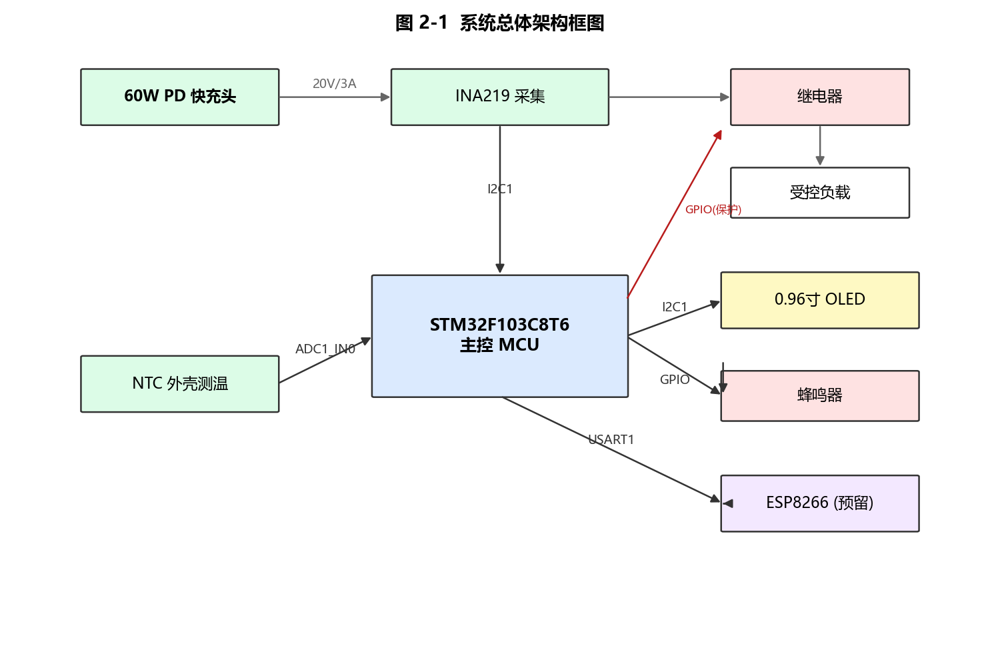
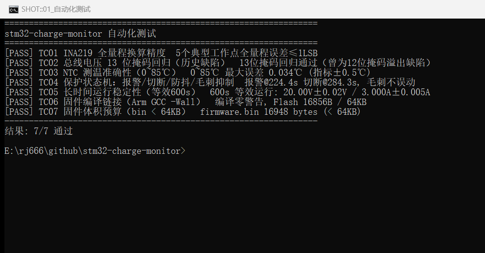

# stm32-charge-monitor — 基于 STM32 的智能充电监控显示系统

以 STM32F103C8T6 为主控的充电安全监控方案：监测低压直流充电回路的电压/电流/功率与被测点温度，OLED 本地显示，超温报警、危险时继电器自动切断低压负载，并预留 ESP8266 + MQTT 物联网上传。

> 当前状态：软件包含驱动、保护逻辑与数值仿真测试；本次安全整改已提交独立分支。**当前尚未在本次会话中完成目标板编译或实物验证**，请按 `TESTS.md` 的步骤复测后再更新测试结论。



## 功能特性

- **电压/电流/功率采集**：INA219（I2C，0.1Ω 分流；电流保护阈值暂设 2.5A，须按模块和分流器规格复核），寄存器级驱动
- **外壳温度监测**：NTC 10kΩ（B3950）+ 12bit ADC + B 参数方程 + 滑动窗口滤波（N=8）
- **本地显示**：0.96 寸 OLED（SSD1306 128×64），帧缓冲驱动，关键参数 8×16 大字号
- **两级安全保护**：45℃ 报警 / 60℃·21V·2.5A 切断，连续 5 周期防抖，切断后闭锁需人工恢复（防热振荡）
- **物联网（可选）**：ESP8266 经 USART1 AT 指令接入 MQTT，1s 周期 JSON 遥测，编译开关整体可裁剪

## 仓库结构

```
stm32-charge-monitor/
├── firmware/
│   ├── Core/Src/            main.c + ina219/ntc/ssd1306/protect/esp8266 六模块
│   ├── Core/Inc/            头文件、引脚与阈值配置
│   ├── GCC_BUILD/           ARM GCC 独立构建脚本（不依赖 Keil/CubeIDE）
│   │   └── build.py         python build.py 一键编译 → build/firmware.bin
│   └── Docs/                CubeMX 配置清单与导入说明
├── simulation/              寄存器级数值仿真（与固件同参数）
│   ├── sim_core.py          换算验证 + 保护场景仿真 + 测试曲线生成
│   └── fig_*.py             论文/展示图生成脚本
├── tests/
│   └── run_tests.py         TC01~TC07 自动化测试入口（python tests/run_tests.py）
├── figures/                 架构/接线/流程/界面/测试曲线图
└── docs/screenshots/        编译、测试、烧录工具的真实运行截图
```

## 快速开始

### 环境

| 工具 | 用途 | 获取 |
|------|------|------|
| Python 3.10+ | 测试与仿真 | [python.org](https://python.org)，需 `numpy matplotlib` |
| Arm GNU Toolchain 13.2 | 固件编译 | [developer.arm.com](https://developer.arm.com/downloads/-/arm-gnu-toolchain-downloads)（mingw-w64-i686-arm-none-eabi） |
| STM32F1 HAL Driver + CMSIS(device_f1 + CMSIS_5 Core/Include) | 编译依赖 | [STMicroelectronics GitHub](https://github.com/STMicroelectronics/stm32f1xx_hal_driver) |
| xPack OpenOCD + ST-Link V2 | 烧录 | [xpack-dev-tools/openocd-xpack](https://github.com/xpack-dev-tools/openocd-xpack/releases) |

### 编译（无需 Keil / STM32CubeIDE）

1. 将 HAL/CMSIS 按下述路径放置（或改 `GCC_BUILD/build.py` 顶部的路径常量）：
   - `STM32F1xx_HAL_Driver/`（`Inc/`、`Src/`）
   - `CMSIS/Device/ST/STM32F1xx/`（cmsis_device_f1 仓库）
   - `CMSIS/Include/`（CMSIS_5 的 `CMSIS/Core/Include`）
2. 运行：

```bash
cd firmware/GCC_BUILD
python build.py
# 期望输出: BUILD OK -> build/firmware.elf, firmware.bin ≈ 16.9KB
```

### 烧录（ST-Link + OpenOCD）

```bash
openocd -f interface/stlink.cfg -f target/stm32f1x.cfg ^
        -c "program firmware/GCC_BUILD/build/firmware.bin 0x08000000 verify reset exit"
```

### 运行自动化测试

```bash
python tests/run_tests.py      # 执行数值测试；编译用例需本机工具链与依赖
```

## 测试结果摘要

| 用例 | 内容 | 结果 |
|------|------|------|
| TC01 | INA219 全量程换算精度（5 工作点） | ✅ 误差 ≤ 1 LSB |
| TC02 | 总线电压 13 位掩码回归 | ✅ 通过（曾为 12 位掩码溢出缺陷，已修复） |
| TC03 | NTC 测温准确性 0~85℃ | ✅ 最大误差 0.034℃（指标 ±0.5℃） |
| TC04 | 保护状态机报警/切断/防抖/毛刺抑制 | ✅ 报警@224s 切断@284s |
| TC05 | 稳定性（等效 600s） | ✅ 20.00V±0.02V / 2.500A±0.005A |
| TC06 | 本机 Arm GCC 编译链接 | 需在本机安装依赖后复测 |
| TC07 | 固件体积预算 | 编译成功后自动检查 |

完整定义与复现方式见 [TESTS.md](TESTS.md)。



## 项目成果

1. **模块化嵌入式固件代码**：包含主循环、INA219、NTC、OLED、保护逻辑与可选 ESP8266 模块；需按仓库说明完成本地编译验证
2. **寄存器级驱动三件套**：INA219（含标定寄存器计算与在线重连）、SSD1306（帧缓冲 + 6×8 字库 + 2×2 放大绘制）、NTC（B 参数方程 + 开路/短路剔除）
3. **两级保护状态机**：报警级/切断级 + 连续 5 周期防抖 + 闭锁恢复，形成"采集—显示—报警—断电"安全闭环
4. **先仿真后联调的验证体系**：与固件同参数的寄存器级建模，在硬件到位前确认算法正确性
5. **可复现的文档与图**：架构/接线/流程/界面/测试曲线全部脚本化生成

## 技术难点与解决

| 难点 | 解决方案 |
|------|----------|
| 总线电压寄存器溢出：母线电压 >16.38V 时读数跳变 | 仿真阶段捕获 12 位掩码错误，依 TI SBOS499E 改为 13 位（0x1FFF），并以回归用例 TC02 锁定 |
| NTC 高阻抗源导致 ADC 采样失真 | 71.5 周期长采样时间 + F1 特有 ADC 上电自校准 + 滑动窗口滤波 |
| 无 RTOS 条件下的多周期任务调度 | SysTick 时基 + 非阻塞固定周期轮询（100ms 采集 / 500ms 显示 / 1000ms 上传），与 INA219 42ms 转换周期匹配 |
| 保护误动作与热振荡 | 连续 5 周期确认、报警滞回、切断闭锁与安全条件恢复 |
| 无 Keil/CubeIDE 环境下的构建 | 自写 GCC 构建脚本（startup/链接脚本/精简 hal_conf），python 一键编译 |

## 安全边界与诚实性说明\n\n- 本项目仅面向隔离、限流的低压直流实验；禁止直接接入市电，禁止在未验证前连接手机或贵重设备。\n- 当前继电器逻辑按 GPIO 高电平吸合、低电平断开编写；实际模块可能存在低电平触发差异，必须先断开负载核验。\n- 0.1Ω 分流电阻在 2.5A 时理论耗散约 0.625W，仍需考虑温升与降额；建议使用额定功率至少 2W 的合适器件并复核 PCB/接线温升。

- TC01~TC05 为**数值仿真/软件模型**，非实物测量；测试结果应以本地实际运行输出为准。
- OLED 界面图为布局示意图，实物照片待样机制作后补充\n- 本仓库不把未执行的本地编译、Altium 编译或硬件测试标记为已通过
- 不存在虚构的部署经历、用户数量或应用单位

## Roadmap

- [ ] 硬件样机实测标定（两点校准压缩分流电阻容差）
- [ ] 温度变化率（dT/dt）预测性预警
- [ ] ESP8266 云端平台接入（历史曲线 / 阈值远程配置）
- [ ] PCB 一体化 + CH224K PD 诱骗取电

## 许可证

[MIT](LICENSE)

## 作者

沈炜丹 · 计算机科学与技术 · 毕业设计项目（指导：王全辉）
