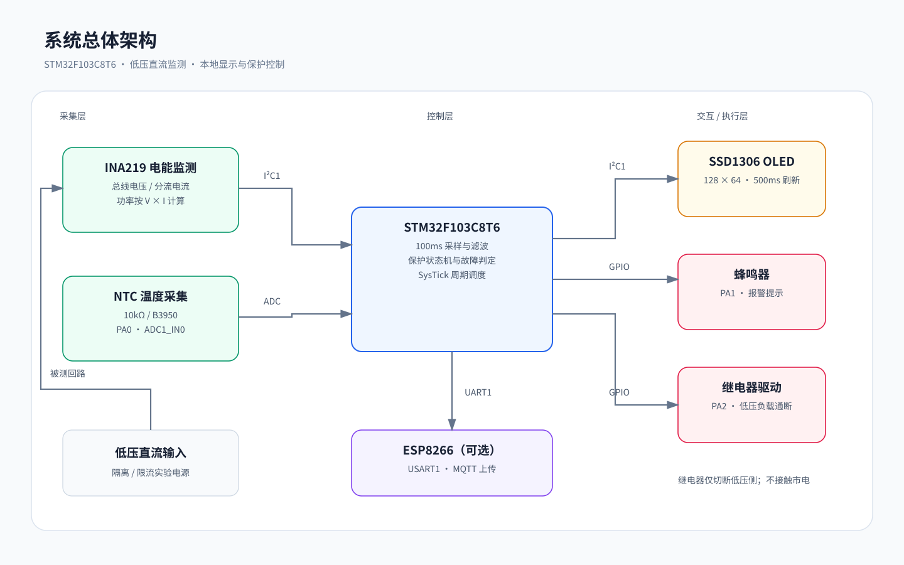

# stm32-charge-monitor — 基于 STM32 的智能充电监控显示系统

以 STM32F103C8T6 为主控的充电安全监控方案：监测低压直流充电回路的电压/电流/功率与被测点温度，OLED 本地显示，超温报警、危险时继电器自动切断低压负载，并预留 ESP8266 + MQTT 物联网上传。

> 当前状态：安全整改已合入 `fix/safety-failsafe-review`（PR #1）。**已在本机用 Arm GCC 完成固件真实编译（0 警告）**、保护状态机 C 代码单元测试框架、Altium 原理图生成器的电气完整性自检与工程 Compile 流程。**尚未完成**：Altium ERC、修复后原理图在 Altium 的复编译确认（当时实例被其他工程占用，未抢占）、烧录与低压实物测试、实体恢复按键。请按 `TESTS.md` 与 `docs/一致性核对与低压测试方案.md` 复测后再更新测试结论。



> 文档图统一改为 SVG 矢量图，放大查看不会明显失真。

## 功能特性

- **电压/电流/功率采集**：INA219（I2C，0.1Ω 分流；电流保护阈值暂设 2.5A，须按模块和分流器规格复核），寄存器级驱动
- **外壳温度监测**：NTC 10kΩ（B3950）+ 12bit ADC + B 参数方程 + 滑动窗口滤波（N=8）
- **本地显示**：0.96 寸 OLED（SSD1306 128×64），帧缓冲驱动，关键参数 8×16 大字号
- **两级安全保护**：45℃ 报警 / 60℃·21V·2.5A 切断，连续 5 周期确认；阈值越限闭锁，传感器故障切断在采样恢复且安全后防抖自动恢复；`Protect_Recover()` 恢复入口已接入主循环（经 `g_recover_req` 软件标志触发，**实体按键/串口命令与二次确认尚未实现**）
- **失效保护**：INA219 OVF 溢出位与 26V 器件上限双重拦截、硬件功率与 V×I 交叉校验、OLED 掉线检测与低频探活、IWDG 独立看门狗（2s，仅健康完成采样周期才喂狗）、继电器驱动 R9 下拉保证复位默认断开
- **被测回路与逻辑供电分离**（原理图 Rev.B）：`J6` DC IN 5–20V 经 R1 分流与继电器到负载，`J1` USB 5V 仅供 MCU/LDO/线圈；INA219 `VBUS` 已补接至 `VIN_DC`。21V 阈值对应 20V 额定测试点，不是监测 MCU 的 5V 供电轨
- **物联网（可选）**：ESP8266 经 USART1 AT 指令接入 MQTT（可选）；当前发送为同步调用，需验证对采样周期的影响

## 仓库结构

```
stm32-charge-monitor/
├── firmware/
│   ├── Core/Src/            main.c + ina219/ntc/ssd1306/protect/esp8266 六模块
│   ├── Core/Inc/            头文件、引脚与阈值配置
│   ├── GCC_BUILD/           ARM GCC 独立构建脚本（不依赖 Keil/CubeIDE）
│   │   └── build.py         python build.py 一键编译 → build/firmware.bin
│   └── Docs/                CubeMX 配置清单与导入说明
├── simulation/              寄存器级数值仿真（与固件同参数）
│   ├── sim_core.py          换算验证 + 保护场景仿真 + 测试曲线生成
│   └── fig_*.py             论文/展示图生成脚本
├── tests/
│   └── run_tests.py         TC01~TC09 自动化测试入口（含 protect.c 真实 C 单测与 SchDoc 双画法校验）
├── figures/                 架构/接线/流程/界面/测试曲线图
└── docs/screenshots/        编译、测试、烧录工具的真实运行截图
```

## 快速开始

### 环境

| 工具 | 用途 | 获取 |
|------|------|------|
| Python 3.10+ | 测试与仿真 | [python.org](https://python.org)，测试脚本无需 numpy；仿真绘图脚本如需运行再安装 matplotlib |
| Arm GNU Toolchain 13.2 | 固件编译 | [developer.arm.com](https://developer.arm.com/downloads/-/arm-gnu-toolchain-downloads)（mingw-w64-i686-arm-none-eabi） |
| STM32F1 HAL Driver + CMSIS(device_f1 + CMSIS_5 Core/Include) | 编译依赖 | [STMicroelectronics GitHub](https://github.com/STMicroelectronics/stm32f1xx_hal_driver) |
| xPack OpenOCD + ST-Link V2 | 烧录 | [xpack-dev-tools/openocd-xpack](https://github.com/xpack-dev-tools/openocd-xpack/releases) |

### 编译（无需 Keil / STM32CubeIDE）

1. 安装 Arm GNU Toolchain，并将 `arm-none-eabi-gcc`、`objcopy`、`size` 加入 PATH；或设置 `ARM_GCC_BIN` 指向工具链 bin 目录。
2. 将 STM32 HAL 与 CMSIS 放在仓库的 `Drivers/STM32F1xx_HAL_Driver/` 和 `Drivers/CMSIS/`；也可通过环境变量 `STM32_HAL_ROOT`、`CMSIS_ROOT` 指定实际目录。
3. 默认目录结构需包含 HAL 的 `Inc/`、`Src/`，以及 CMSIS 的 `Device/ST/STM32F1xx/Include`、`Include/`。
4. 运行：

```bash
cd firmware/GCC_BUILD
python build.py
# 成功时生成 build/firmware.elf 与 firmware.bin；以本机实际输出为准
```

### 烧录（ST-Link + OpenOCD）

```bash
openocd -f interface/stlink.cfg -f target/stm32f1x.cfg ^
        -c "program firmware/GCC_BUILD/build/firmware.bin 0x08000000 verify reset exit"
```

### 运行自动化测试

```bash
python tests/run_current_checks.py      # 执行数值测试；编译用例需本机工具链与依赖
```

## 测试结果摘要

| 用例 | 类型 | 当前状态 |
|------|------|------|
| TC01–TC05 | 数值模型 / 仿真 | 本机已通过；**不等同于 C 固件或实物测试** |
| TC06–TC07 | Arm GCC 编译与体积检查 | 本机已通过（0 警告，`firmware.bin` < 64KB） |
| TC08 | `protect.c` 真实 C 代码单元测试 | 已用 ARM GCC `-Wall -Wextra` 编译检查通过；本机无 x86 gcc/clang，实际执行需 CI 或装有原生编译器的机器，本机报 SKIP |
| TC09 | Altium SchDoc 网表 + 电气热点 + 双画法回归（文本级） | 本机已通过：25 网络 / 99 引脚 / 101 导线 / 54 标号 / 43 电源端口与生成器对齐，99 个引脚热点 + 97 个标号/端口全部落在导线端点；内置 stub/direct 正反例回归 5/5，另用 7 图纸 OLE 工程交叉验证 `direct` 判定与悬空诊断 |
| Altium Compile | 原理图工程编译 | Rev.B 本机 Altium 17.0 实测 **`Compile successful, no errors found.`**（0 error）；Rev.C 已修复 97 条 Floating 警告的引脚热点根因并静态验证，**GUI 复编译待做**；ERC 未执行 |
| HT-1–HT-5 | 实物测量 | 样机完成后执行，**尚未开展** |

不要把历史仿真输出当作当前版本的最新通过记录；完整口径见 [TESTS.md](TESTS.md)。

完整定义与复现方式见 [TESTS.md](TESTS.md)。

<!-- 测试截图仅在确认对应当前版本、且能辨认命令与结果后再展示 -->

## 项目成果

1. **模块化嵌入式固件代码**：包含主循环、INA219、NTC、OLED、保护逻辑与可选 ESP8266 模块；已按仓库说明完成本机编译验证（0 警告）
2. **寄存器级驱动三件套**：INA219（含标定寄存器计算与在线重连）、SSD1306（帧缓冲 + 6×8 字库 + 2×2 放大绘制）、NTC（B 参数方程 + 开路/短路剔除）
3. **两级保护状态机**：报警级/切断级 + 连续 5 周期防抖 + 区分"传感器故障自动恢复 / 阈值越限闭锁 + 显式恢复" + 恢复安全门卫，形成"采集—显示—报警—断电"安全闭环；抽成 HAL 无关纯 C 模块后可直接在主机单测
4. **先仿真后联调的验证体系**：与固件同参数的寄存器级建模，在硬件到位前确认算法正确性
5. **可复现的文档与图**：架构/接线/流程/界面/测试曲线全部脚本化生成

## 技术难点与解决

| 难点 | 解决方案 |
|------|----------|
| 总线电压寄存器溢出：母线电压 >16.38V 时读数跳变 | 仿真阶段捕获 12 位掩码错误，依 TI SBOS499E 改为 13 位（0x1FFF），并以回归用例 TC02 锁定 |
| NTC 高阻抗源导致 ADC 采样失真 | 71.5 周期长采样时间 + F1 特有 ADC 上电自校准 + 滑动窗口滤波 |
| 无 RTOS 条件下的多周期任务调度 | SysTick 时基 + 固定周期轮询（100ms 采集 / 500ms 显示 / 1000ms 可选上传）；ESP8266_SendData 当前为同步调用，启用后可能阻塞主循环 |
| 保护误动作与热振荡 | 连续 5 周期确认、报警滞回、切断闭锁与安全条件恢复 |
| 切断后永久断电（恢复入口缺失） | 区分故障原因：传感器故障自动恢复，阈值越限闭锁并由 `Protect_Recover()` + 安全门卫显式解除 |
| 外设掉线拖垮保护节拍 | `SSD1306_Update()` 返回 I2C 状态，连续 3 次失败标记掉线并停止 500ms 重试，改为 5s 低频探活；IWDG 仅健康完成采样周期才喂狗 |
| 无 Keil/CubeIDE 环境下的构建 | 自写 GCC 构建脚本（startup/链接脚本/精简 hal_conf），python 一键编译；链接脚本补 `end`/`_end` 供 newlib nano `_sbrk` |
| 原理图漏接 INA219 VBUS / 被测回路与逻辑供电混网 | 生成器内置引脚覆盖自检 + Rev.B 电源域分离（`+5V` / `VIN_DC`），补 `U2.VBUS`、R9 下拉、R1 改 2W |

## 安全边界与诚实性说明

- 本项目仅面向隔离、限流的低压直流实验；禁止直接接入市电，禁止在未验证前连接手机或贵重设备。被测输入 `J6` 负端须与 MCU 共地。
- 当前继电器逻辑按 GPIO 高电平吸合、低电平断开编写；实际模块可能存在低电平触发差异，必须先断开负载核验。R9 下拉只保证 MCU 复位期间 Q2 截止，不能替代触发电平核验。
- 0.1Ω 分流电阻在 2.5A 时理论耗散约 0.625W，原理图已标 **2W**，仍需复核温升、焊盘与铜箔。
- INA219 的 VBUS 规格上限 **26V**；寄存器编码跨度 32.76V 不代表可承受电压。
- TC01~TC05 为**数值仿真/软件模型**，非实物测量；TC08 是真实 C 代码单测，但本机缺原生编译器时仅编译检查、报 SKIP。
- OLED 界面图为布局示意图，实物照片待样机制作后补充。
- 本仓库不把未执行的 Altium ERC、烧录与硬件测试标记为已通过；不存在虚构的部署经历、用户数量或应用单位。

## Roadmap

- [ ] 硬件样机实测标定（两点校准压缩分流电阻容差）
- [ ] 温度变化率（dT/dt）预测性预警
- [ ] ESP8266 云端平台接入（历史曲线 / 阈值远程配置）
- [ ] PCB 一体化 + CH224K PD 诱骗取电

## 许可证

[MIT](LICENSE)

## 作者

沈炜丹 · 计算机科学与技术 · 毕业设计项目（指导：王全辉）
